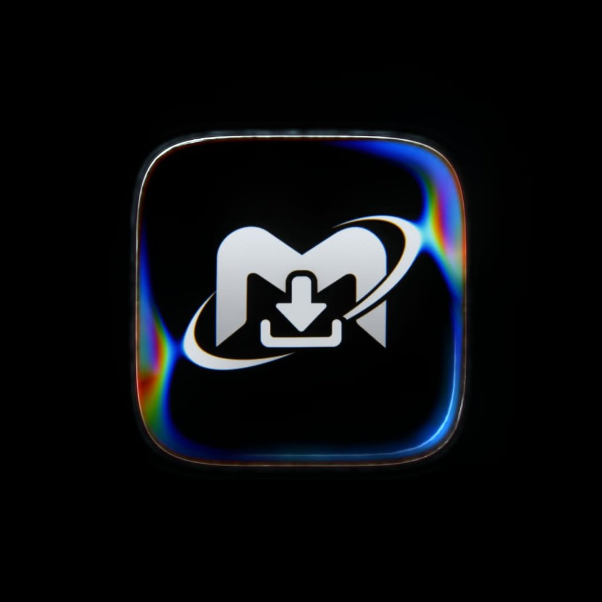
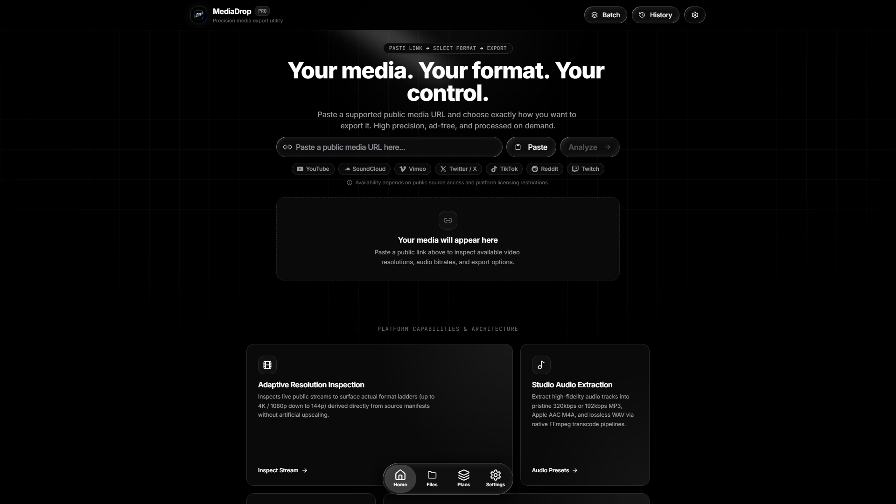
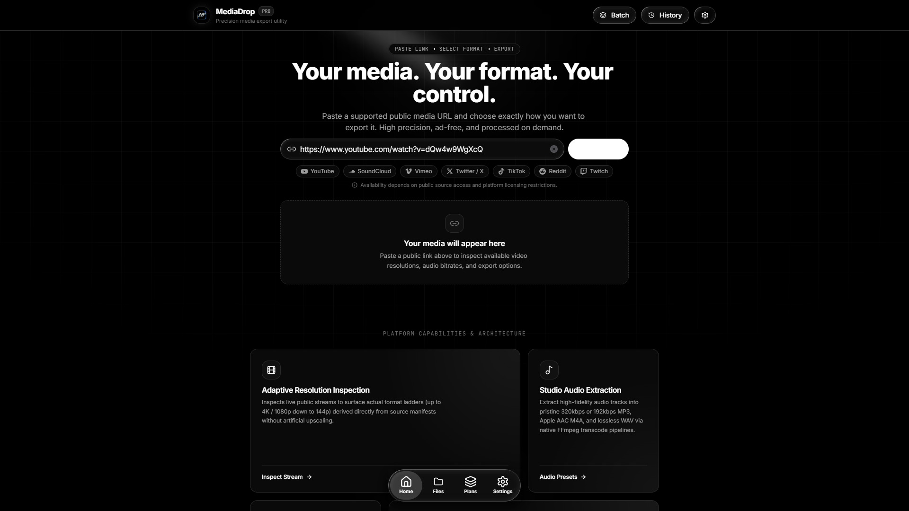
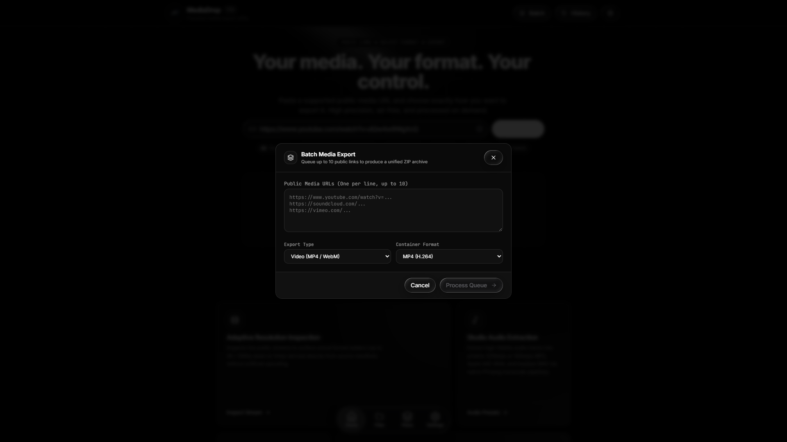

<div align="center">



# MediaDrop 💧

**Precision Media Processing • Ad-Free • Apple Liquid Glass UI • Privacy-First**

[](https://nextjs.org/)
[](https://fastapi.tiangolo.com/)
[](https://www.python.org/)
[](https://tailwindcss.com/)
[](LICENSE)

*Your media. Your format. Your control.*

</div>

---

## ✦ Overview

**MediaDrop** is an exceptionally polished, zero-ad, privacy-respecting media processing application. Engineered for high performance and tactile aesthetics, it pairs **Next.js 15 App Router** and **Python FastAPI** with an Apple-inspired **Liquid Glass** interface and a strict monochrome design language.

Say goodbye to ad-riddled, malware-laden web converters. MediaDrop extracts public media, transcodes audio, clips timestamps, and packages batch downloads on demand with sub-second responsiveness.

---

## ✦ Application Screenshots

### 1. Hero Landing & Apple Liquid Glass Dock


### 2. URL Input & Interactive Extraction


### 3. Multi-URL Batch Queue Modal


---

## ✦ Key Features

- **Liquid Glass Design System**: Selective Apple-inspired glass elements using `@zakisheriff/liquid-glass`, including a floating magnification dock (`GlassNav`), chromatic blur cards (`GlassCard`), translucent inputs (`GlassInput`), and spring-animated buttons (`GlassButton`).
- **Multi-Platform Support**: Powered by `yt-dlp` for extracting public media from YouTube, Vimeo, SoundCloud, Instagram, TikTok, Twitter/X, Reddit, Twitch, Facebook, and hundreds more.
- **Precision Audio Extraction**: Extract pure audio in high-bitrate MP3 (320 kbps, 256 kbps, 192 kbps, 128 kbps), lossless WAV, FLAC, and AAC.
- **Sub-Second Video Trimming**: Specify exact start and end timestamps (`HH:MM:SS`) to crop highlight clips directly on the server without downloading unwanted footage.
- **Multi-Item Batch Queue**: Queue up to 10 URLs simultaneously and download them in a single aggregated `.zip` archive.
- **Zero-Node Local Windows Launcher**: Windows users can launch the complete full-stack application with a single double-click—no Node.js or `npm` required.
- **Netlify Drag-and-Drop Ready**: Built as a fully decoupled, static HTML Single-Page Application (SPA) ready to deploy to Netlify via drag-and-drop.
- **Enterprise Security & Firewall**:
  - **SSRF Protection**: Hardened DNS resolver that blocks private IP ranges, loopback addresses (`127.0.0.1`), link-local IPs (`169.254.169.254`), and cloud provider metadata endpoints (AWS, GCP, Azure, DigitalOcean).
  - **Path Traversal Shield**: Strict filename sanitization removing shell characters, null bytes, and traversal attempts (`../`).
  - **Ephemeral Disk Cleanup**: Background workers purge temporary files immediately upon stream completion or after a configurable retention window.

---

## ✦ Quick Launch for Windows Users (1-Click)

MediaDrop includes an automated launcher that serves the pre-compiled production frontend via Python's built-in HTTP server with client-side SPA fallback. **End users only need Python 3.10+ installed—no Node.js or npm required.**

### 1. Download or Clone
Extract the MediaDrop repository or the `MediaDrop-Windows.zip` release bundle.

### 2. Double-Click `Start MediaDrop.bat`
```
Start MediaDrop.bat
```
- Automatically verifies your Python environment and installs dependencies on first run.
- Starts the FastAPI backend engine on port `8000`.
- Starts the lightweight production frontend server on port `3000`.
- Waits for the backend health check to pass.
- Automatically launches your default web browser to `http://localhost:3000`.

### 3. Stopping MediaDrop
- Close the launcher window, press any key in the console, OR
- Double-click `Stop MediaDrop.bat` to cleanly terminate all processes on ports 8000 and 3000.

> **Optional: FFmpeg for Audio Conversion & Trimming**  
> For complete MP3/WAV extraction and video trimming:  
> Run in PowerShell: `winget install Gyan.FFmpeg.Essentials`  
> *Or place `ffmpeg.exe` and `ffprobe.exe` directly inside the `bin\` folder.*

---

## ✦ Netlify Drag-and-Drop Deployment

MediaDrop's frontend is pre-configured and exported to `release/netlify/` as a static Single Page Application.

### To Deploy:
1. Open the [Netlify Drop](https://app.netlify.com/drop) dashboard.
2. Drag and drop the **`release/netlify`** folder into the browser window.
3. Your site is instantly live on a global CDN with:
   - `_redirects` configured for seamless client-side SPA routing (`/* /index.html 200`).
   - `netlify.toml` with cache optimization and security headers.
4. In the deployed web UI, click **Settings** (or the gear icon in the dock) and enter your public FastAPI backend URL (e.g. `https://mediadrop-api.onrender.com`).

---

## ✦ Cloud Backend Deployment (Render / Docker)

### Render Blueprint (1-Click)
This repository includes a `render.yaml` configuration that deploys the FastAPI backend with Python 3.11 and system FFmpeg:
1. Connect your GitHub repository to [Render](https://render.com).
2. Create a new **Blueprint Instance** pointing to `render.yaml`.
3. Render automatically builds the container, installs FFmpeg, and exposes the REST API with health check polling at `/api/health`.

### Dockerfile
Deploy to any container host (Railway, Fly.io, DigitalOcean App Platform, AWS ECS):
```bash
docker build -t mediadrop-backend -f backend/Dockerfile .
docker run -p 8000:8000 -e ALLOWED_ORIGINS="https://your-frontend.netlify.app" mediadrop-backend
```

---

## ✦ Developer Setup

For developers modifying the code:

### Frontend
```bash
cd frontend
npm install
npm run dev
# Running on http://localhost:3000
```

To build a fresh static export:
```bash
npm run build
# Output generated in frontend/out/
```

### Backend
```bash
cd backend
python -m venv .venv
# Windows:
.venv\Scripts\activate
# Linux/macOS:
source .venv/bin/activate

pip install -r requirements.txt
uvicorn app.main:app --reload --port 8000
# API docs at http://127.0.0.1:8000/api/docs
```

### Run Automated Tests
```bash
pytest backend/tests -v
```

---

## ✦ Repository Architecture

```
mediadrop/
├── Start MediaDrop.bat          # 1-Click Windows launcher (starts backend + frontend, opens browser)
├── Stop MediaDrop.bat           # 1-Click Windows process terminator
├── Setup MediaDrop.bat          # Virtual environment & dependency installer
├── backend_server.py           # Python backend runner (Uvicorn + FastAPI)
├── serve_frontend.py           # Python zero-dependency static SPA server
├── manage_servers.py           # Port monitor, health check poller & process killer
├── render.yaml                 # Render Blueprint configuration
├── LICENSE                     # MIT License
├── README.md                   # Complete documentation
│
├── release/
│   ├── netlify/                # Pre-built static export ready for Netlify drag-and-drop
│   │   ├── _redirects          # SPA client-side routing rules
│   │   ├── netlify.toml        # Security & CDN cache headers
│   │   ├── index.html          # Next.js static landing page
│   │   └── _next/              # Optimized JS bundles & CSS
│   └── MediaDrop-Windows.zip   # Portable standalone Windows release archive
│
├── frontend/                   # Next.js 15 App Router Frontend
│   ├── app/
│   │   ├── globals.css         # Liquid glass styles & monochrome theme overrides
│   │   ├── layout.tsx          # Root layout with Inter font & app metadata
│   │   ├── not-found.tsx       # Static export 404 handler
│   │   └── page.tsx            # Orchestrates state, modal drawers & liquid dock
│   ├── components/
│   │   ├── navigation/         # Liquid Glass floating dock & pill nav
│   │   ├── ui/                 # Liquid glass buttons, cards, inputs & loaders
│   │   ├── Header.tsx          # App header with official chromatic logo
│   │   ├── Hero.tsx            # Hero typography & Aceternity Spotlight
│   │   ├── PlatformBadges.tsx  # Supported media service pills
│   │   ├── CapabilityCards.tsx # Magic UI Bento Grid
│   │   ├── OutputPanel.tsx     # Format picker, resolution selector & trimming
│   │   ├── BatchModal.tsx      # Multi-URL batch download modal
│   │   ├── HistoryDrawer.tsx   # Local download history drawer
│   │   └── SettingsModal.tsx   # Custom backend URL & format preferences
│   ├── public/
│   │   └── logo.png            # Official MediaDrop chromatic logo
│   └── next.config.mjs         # Static export configuration (output: 'export')
│
├── backend/                    # Python FastAPI Backend
│   ├── app/
│   │   ├── api/routes.py       # REST endpoints (/health, /parse, /download, /convert, /batch)
│   │   ├── core/
│   │   │   ├── config.py       # Environment settings & allowed origins
│   │   │   ├── firewall.py     # SSRF defense, IP blacklist & DNS validation
│   │   │   └── limiter.py      # IP rate limiter
│   │   ├── models/schemas.py   # Pydantic request & response schemas
│   │   ├── services/
│   │   │   ├── ytdlp_service.py   # yt-dlp metadata extraction & direct streaming
│   │   │   ├── ffmpeg_service.py  # Audio transcoding & sub-second trimming
│   │   │   └── cleanup.py         # Ephemeral file purge routines
│   │   └── main.py             # FastAPI application initialization
│   ├── tests/                  # Security, parser & SSRF pytest test suite
│   ├── Dockerfile              # Multi-stage Debian bullseye image with FFmpeg
│   └── requirements.txt
│
└── docs/
    └── screenshots/            # 1920x1080 captured application screenshots
```

---

## ✦ REST API Reference

| Method | Endpoint | Description |
|---|---|---|
| `GET` | `/api/health` | Service health status, uptime, and FFmpeg detection |
| `POST` | `/api/parse` | Parse public media URL, return title, duration, thumbnail, formats |
| `POST` | `/api/download` | Stream extracted video/audio stream with optional trimming |
| `POST` | `/api/convert` | Transcode media into specified format (MP3, WAV, AAC, MP4) |
| `POST` | `/api/batch` | Download multiple URLs and assemble into a single `.zip` file |

Interactive Swagger documentation is available at `http://127.0.0.1:8000/api/docs`.

---

## ✦ Legal & Security Disclaimer

- **Terms of Service**: MediaDrop is designed for processing personal media, public domain works, and content for which you have explicit rights or fair-use permissions.
- **No Circumvention**: MediaDrop does not circumvent DRM, decrypt protected streams, or bypass subscription paywalls.
- **Privacy Guarantee**: MediaDrop stores zero logs of downloaded content, saves no cookies or trackers, and operates entirely statelessly.

---

## ✦ License

MediaDrop is open-source software licensed under the [MIT License](LICENSE).
Third-party licenses for incorporated libraries are detailed in [THIRD-PARTY-LICENSES.txt](THIRD-PARTY-LICENSES.txt).
